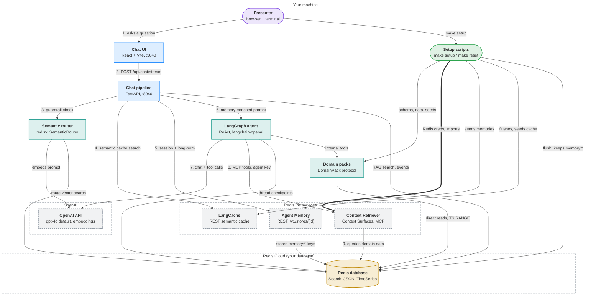
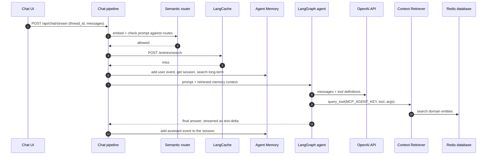
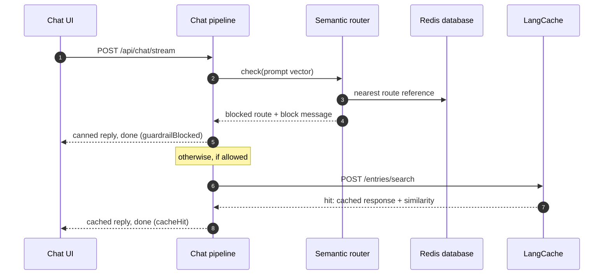
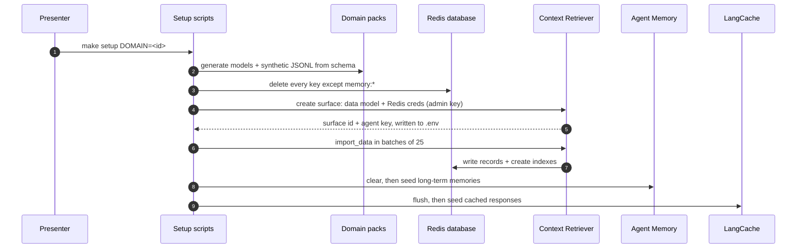

<!-- Generated by visualizer from architecture.json. Don't edit this file: edit the model, or rerun /visualizer:architecture. -->

# Redis Iris Demos architecture

A local demo app that shows Redis Iris behind a chat agent, with one swappable domain pack per industry. A React chat UI streams each question to a FastAPI backend, which runs a fixed pipeline: a semantic-routing guardrail, a LangCache lookup, Agent Memory enrichment, then a LangGraph ReAct agent on OpenAI. The agent reads business data through Context Retriever MCP tools, which query the demo's Redis database. Setup scripts generate synthetic data for the active domain, create a Context Surface, load the data and seed memory and cache.

**Highlights**

- All credentials sit in the local `.env` and are read by the backend and setup scripts; the browser holds none.
- `make setup` sends the Redis password to the Context Surfaces admin API, so Context Retriever reaches your database with it.
- At runtime the agent uses only the per-surface `MCP_AGENT_KEY`; `CTX_ADMIN_KEY` is used by setup scripts alone.
- One Redis database holds demo data, LangGraph checkpoints, router vectors and Agent Memory's `memory:*` keys; `flush_redis.py` wipes all but `memory:*`.
- Every prompt leaves the machine to OpenAI, LangCache and Agent Memory before the agent runs.

## Overview

| Shape | Colour | Meaning |
|---|---|---|
| Rounded box | green | Entry point: something you run |
| Rounded box | purple | Client: a person or app that uses the system |
| Box | blue | Service you run |
| Box | teal | Module inside a program |
| Cylinder | yellow | Datastore: where state lives |
| Dashed box | grey | External system you don't run |
| Dashed outline | — | Trust or deployment boundary |
| Solid arrow | — | Call or request |
| Thick arrow | — | Sign-in or credential flow |
| 1. 2. 3. before a label | — | The main path, in order |

## Components

| Component | Kind | Runs in | Responsibility | Evidence |
|---|---|---|---|---|
| **Presenter** browser + terminal | client | Your machine | Runs make setup and make dev, then chats with the domain assistant in the browser. | [`README.md#getting-started`](../../README.md#getting-started), [`Makefile`](../../Makefile) |
| **Chat UI** React + Vite, :3040 | service | Your machine | Branded chat and activity panel; streams answers and tool traces over SSE, proxying /api to the backend. | [`frontend/src/App.tsx`](../../frontend/src/App.tsx), [`frontend/src/components/ActivityPanel.tsx`](../../frontend/src/components/ActivityPanel.tsx), [`frontend/vite.config.ts`](../../frontend/vite.config.ts) |
| **Chat pipeline** FastAPI, :8040 | service | Your machine | Runs guardrail, cache, memory and agent phases for each message and streams every step back as SSE. | [`backend/app/main.py`](../../backend/app/main.py), [`backend/app/langcache_service.py`](../../backend/app/langcache_service.py), [`backend/app/memory_service.py`](../../backend/app/memory_service.py), [`backend/app/rag_service.py`](../../backend/app/rag_service.py) |
| **Semantic router** redisvl SemanticRouter | module | Your machine | Blocks off-topic or disallowed prompts by vector distance to the domain's guardrail routes. | [`backend/app/guardrail_service.py`](../../backend/app/guardrail_service.py) |
| **LangGraph agent** ReAct, langchain-openai | module | Your machine | Plans with the LLM, calls MCP and domain tools, and keeps thread state in a Redis checkpointer. | [`backend/app/langgraph_agent.py`](../../backend/app/langgraph_agent.py), [`backend/app/context_surface_service.py`](../../backend/app/context_surface_service.py) |
| **Domain packs** DomainPack protocol Includes: Redis Eats (reddash), ElectroHub, ShiftIQ (finance-researcher), RedHealthConnect (healthcare), Radish Bank, R-Mobile, Sports Desk | module | Your machine | One per industry: schema, branding, prompt, guardrail routes, seeds and internal tools. DEMO_DOMAIN picks one. | [`backend/app/core/domain_contract.py`](../../backend/app/core/domain_contract.py), [`backend/app/core/domain_loader.py`](../../backend/app/core/domain_loader.py), [`backend/app/internal_tools.py`](../../backend/app/internal_tools.py), [`domains/`](../../domains/) |
| **Setup scripts** make setup / make reset Includes: generate_models, generate_data, flush_redis, setup_surface, load_data, seed_memories, seed_langcache | entrypoint | Your machine | Generates models and data for the active domain, provisions the surface, loads Redis, seeds memory and cache. | [`Makefile`](../../Makefile), [`scripts/generate_models.py`](../../scripts/generate_models.py), [`scripts/generate_data.py`](../../scripts/generate_data.py), [`scripts/flush_redis.py`](../../scripts/flush_redis.py), [`scripts/setup_surface.py`](../../scripts/setup_surface.py), [`scripts/load_data.py`](../../scripts/load_data.py), [`scripts/seed_memories.py`](../../scripts/seed_memories.py), [`scripts/seed_langcache.py`](../../scripts/seed_langcache.py), [`README.md#what-make-setup-does`](../../README.md#what-make-setup-does) |
| **LangCache** REST semantic cache | external | Redis Iris services | Returns a stored answer when a new prompt is semantically close to a cached one. | [`backend/app/langcache_service.py`](../../backend/app/langcache_service.py), [`scripts/seed_langcache.py`](../../scripts/seed_langcache.py) |
| **Agent Memory** REST, /v1/stores/{id} | external | Redis Iris services | Keeps short-term session events and searchable long-term memories per user. | [`backend/app/memory_service.py`](../../backend/app/memory_service.py), [`scripts/seed_memories.py`](../../scripts/seed_memories.py) |
| **Context Retriever** Context Surfaces, MCP | external | Redis Iris services | Exposes the domain's data model as MCP tools and imports records into your Redis database. | [`backend/app/context_surface_service.py`](../../backend/app/context_surface_service.py), [`scripts/setup_surface.py`](../../scripts/setup_surface.py), [`scripts/load_data.py`](../../scripts/load_data.py) |
| **Redis database** Search, JSON, TimeSeries | datastore | Redis Cloud (your database) | The one database behind every domain: business data, agent state, router vectors and memory. | [`backend/app/redis_connection.py`](../../backend/app/redis_connection.py), [`backend/app/langgraph_agent.py`](../../backend/app/langgraph_agent.py), [`backend/app/domain_events.py`](../../backend/app/domain_events.py), [`scripts/flush_redis.py`](../../scripts/flush_redis.py), [`README.md#redis-cloud-services-needed`](../../README.md#redis-cloud-services-needed) |
| **OpenAI API** gpt-4o default, embeddings | external | OpenAI | Chat model for the agent and verifier, and embeddings for the guardrail and the simple-RAG mode. | [`backend/app/settings.py`](../../backend/app/settings.py), [`backend/app/langgraph_agent.py`](../../backend/app/langgraph_agent.py), [`backend/app/guardrail_service.py`](../../backend/app/guardrail_service.py) |

## Where state lives

| Store | Runs in | Holds | Lifetime | Reached by |
|---|---|---|---|---|
| **Redis database** | Redis Cloud (your database) | Domain entities as JSON with search and vector indexes | Until the next make setup or make reset | Context Retriever, Semantic router, LangGraph agent, Domain packs, Agent Memory, Chat pipeline, Setup scripts |
| **Redis database** | Redis Cloud (your database) | LangGraph checkpoints per thread_id | No TTL; until the next flush | Context Retriever, Semantic router, LangGraph agent, Domain packs, Agent Memory, Chat pipeline, Setup scripts |
| **Redis database** | Redis Cloud (your database) | Guardrail route vectors | Rebuilt on every backend start | Context Retriever, Semantic router, LangGraph agent, Domain packs, Agent Memory, Chat pipeline, Setup scripts |
| **Redis database** | Redis Cloud (your database) | Agent Memory memory:* keys and index | Survive flush; cleared by seed_memories | Context Retriever, Semantic router, LangGraph agent, Domain packs, Agent Memory, Chat pipeline, Setup scripts |
| **Redis database** | Redis Cloud (your database) | Domain extras: dataset meta, time series, event stream | Until the next flush | Context Retriever, Semantic router, LangGraph agent, Domain packs, Agent Memory, Chat pipeline, Setup scripts |

## Flows

### A chat turn that reaches the agent

A question that passes the guardrail and misses the cache. Every step is streamed to the activity panel as an SSE tool-call or tool-result event.

### Guardrail block and cache hit

The two ways a turn ends before the agent runs, so no chat model call is made.

### make setup for a domain

First run or a domain switch. make reset skips model generation and reuses the data files.

---

Generated by visualizer from [`architecture.json`](architecture.json). Model as of commit `48e31df` (2026-07-28). Content hash `3fd358aa8902`.
